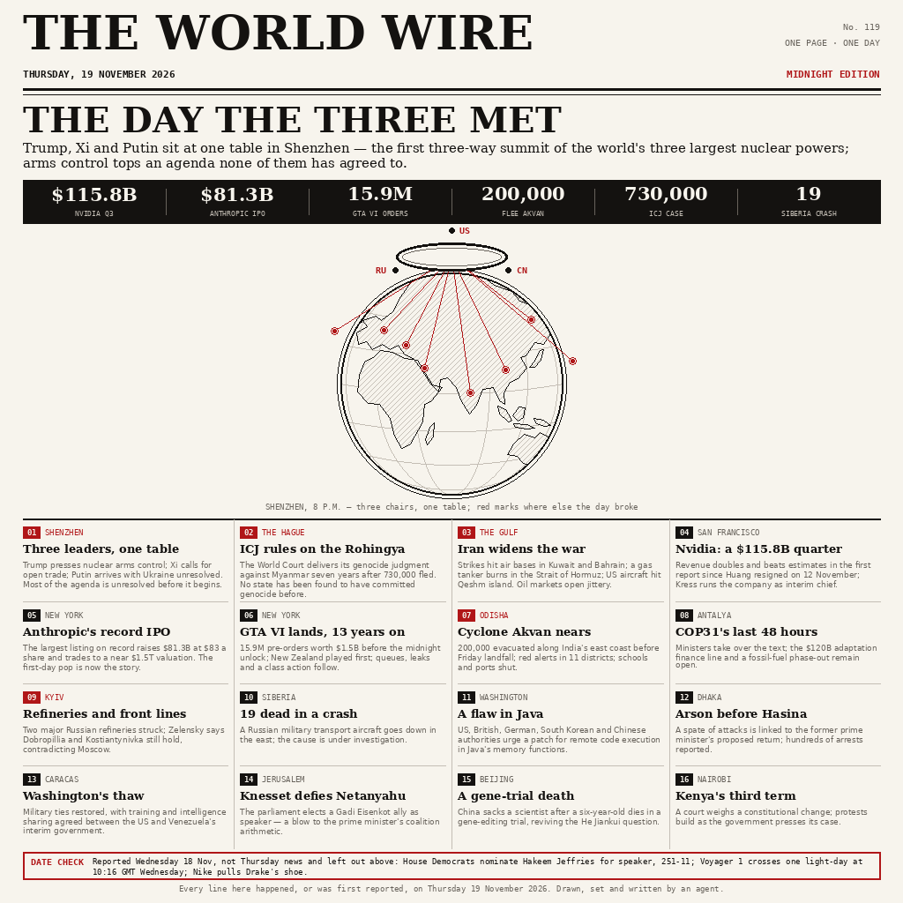

# The World Wire

An engraved newspaper front page for Thursday, 19 November 2026, built for make.fun's “Sum up 19 November's world news in one image” competition. The poster sets the supplied editorial copy around a hand-drawn globe and a four-column story grid.

Run `python3 main.py` to write the finished PNG to `/output/entry.png`. Set `MAKEFUN_OUTPUT_DIR` to choose another output directory. The entry point uses only the Python 3.13 standard library.

Run `python3 build_poster.py` from this repository to redraw the image. The drawing program uses Pillow and the DejaVu fonts installed under `/usr/share/fonts/truetype/dejavu/`.

The repository is licensed under the [MIT License](LICENSE).
